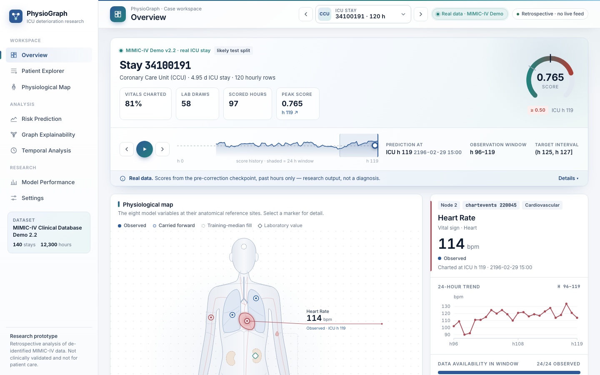
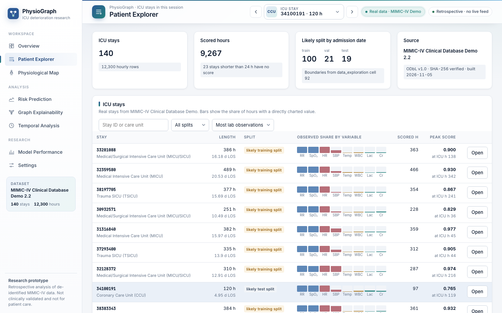
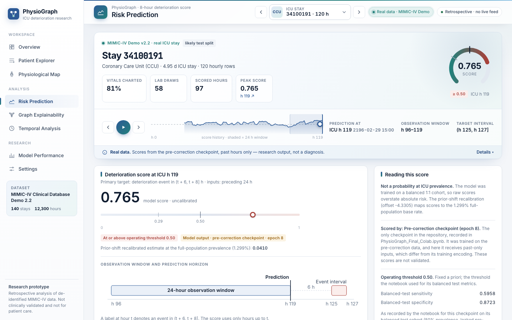
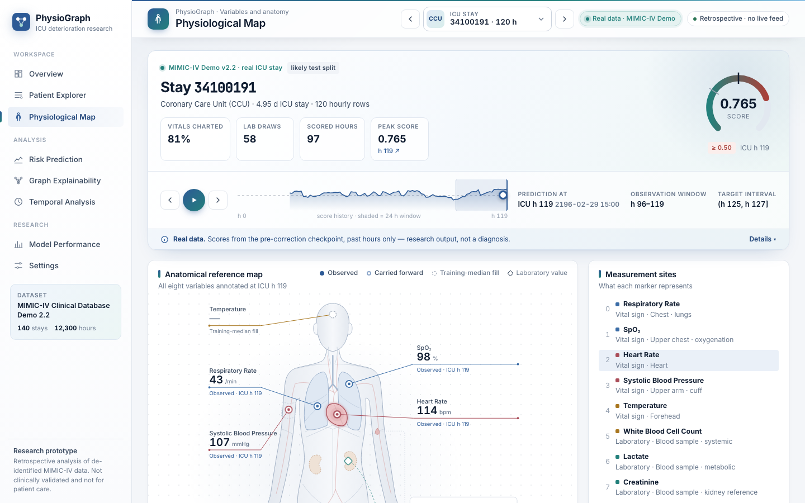
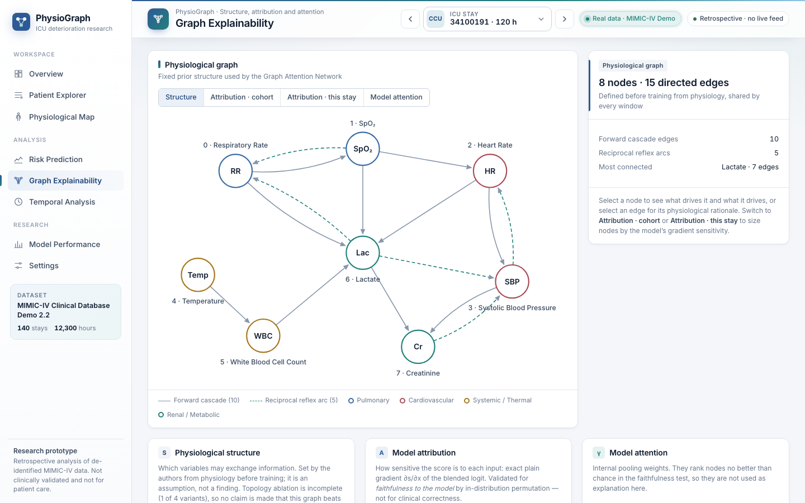

# PhysioGraph: Spatio-Temporal Graph Neural Network for Early ICU Patient Deterioration Detection

[](https://www.python.org/downloads/)
[](https://pytorch.org/)
[](https://pytorch-geometric.readthedocs.io/)
[](https://physionet.org/content/mimiciv/3.1/)
[](https://opensource.org/licenses/MIT)

> **PhysioGraph** is an explainable spatio-temporal graph neural network architecture designed for early, multi-horizon prediction of acute clinical deterioration in Intensive Care Unit (ICU) patients. Grounded in critical-care physiology, PhysioGraph models the human body as an **8-node, 15-edge directed graph** reflecting established pathophysiological cascade pathways and homeostatic reflex arcs.
>
> The system combines **Graph Attention Networks (GAT)** for spatial cross-organ interaction, **Causal Temporal Convolutional Networks (TCN)** with a 31-hour receptive field over 24-hour lookback windows, **Dual Attention Pooling** (trajectory inflection + organ crisis attribution), and **Multi-Horizon Auxiliary Supervision** ($H \in \{6, 8, 12\}$ hours) to deliver reliable advance warning before acute collapse.

---

## 🖥️ Interactive Clinical Dashboard

PhysioGraph features an interactive, browser-based clinical telemetry dashboard designed for ICU bedside surveillance and retrospective research exploration. Built with modular vanilla JavaScript and CSS, it requires no Node/npm dependencies and runs immediately with Python's built-in HTTP server.

```bash
# Launch the dashboard locally
python -m http.server 8000 --directory dashboard
# Open http://localhost:8000 in your browser
```

### 1. Clinical Overview & Patient Workspace
Comprehensive ICU stay monitor tracking real-time deterioration risk, 24-hour observation windows, peak risk score radial gauges, charted vitals completeness, and bedside observation intervals.

<p align="center">
  
</p>

---

### 2. Multi-Stay Patient Explorer
Allows clinicians and researchers to search, filter by ICU care unit (MICU, SICU, CCU, TSICU), and inspect patient trajectories with real-time risk scores and data availability indicators.

<p align="center">
  
</p>

---

### 3. Dynamic Risk Prediction & Advance Warning Window
Hour-by-hour dynamic risk tracking displaying uncalibrated model scores alongside Saerens Bayesian prior-shift recalibrated estimates (adjusting balanced training prevalence to real-world 1.30% hospital base rates). Illustrates the 24-hour lookback window advancing to a 6–8 hour early intervention target interval.

<p align="center">
  
</p>

---

### 4. Anatomical Physiological Map
Interactive anatomical body visualization mapping bedside variables to their biological organ sites, displaying physical units, 24-hour rolling trends, and measurement availability.

<p align="center">
  
</p>

---

### 5. Dynamic Graph Explainability & Organ Attribution
Interactive physiological graph rendering the 8 organ nodes and 15 directed pathways. Features toggleable tabs for graph structure, cohort-level gradient attribution, stay-specific feature sensitivity, and internal multi-head attention weights.

<p align="center">
  
</p>

---

## 🧬 Scientific & Architectural Overview

PhysioGraph formulates organ failure not as isolated tabular vitals, but as an explicit dynamical system across four primary physiological axes:

```
   (Resp Rate) <====== Carotid Reflex ======> (SpO2)
        | \                                     |  \
        |   \                                 Tissue \
    Hypoxia   \                               Glycolysis\
        |       \                               v       v
        v         \-----------------------> (Lactate) <--- (WBC)
   (Heart Rate) <==== Baroreceptor Reflex ===> (SBP)        ^
                                                |          |
                                          Pre-renal AKI   SIRS
                                                |          |
                                                v          |
                                          (Creatinine)   (Temp)
```

### 1. 8 Core Physiological Organ Nodes
* **Pulmonary Axis:** Respiratory Rate (`resp_rate`), Oxygen Saturation (`spo2`)
* **Cardiovascular Axis:** Heart Rate (`heart_rate`), Systolic Blood Pressure (`sbp`)
* **Systemic / Thermal Axis:** Body Temperature (`temperature`), White Blood Cell Count (`wbc`)
* **Renal / Metabolic Axis:** Serum Lactate (`lactate`), Serum Creatinine (`creatinine`)

### 2. 15 Directed Anatomical Pathways
* **10 Forward Cascade Pathways:**
  * `RR -> SpO2`: Hypoxemic respiratory failure
  * `SpO2 -> HR`: Compensatory tachycardia to tissue hypoxia
  * `HR -> SBP`: Perfusion pressure and cardiac output dynamics
  * `SBP -> Creatinine`: Renal hypoperfusion and pre-renal acute kidney injury
  * `Lactate -> Creatinine`: Metabolic acidosis compounding acute renal tubular necrosis
  * `Temp -> WBC`: Systemic inflammatory response syndrome (SIRS) and pyrexia
  * `WBC -> Lactate`: Microcirculatory hypoperfusion and septic tissue hypoxia
  * `RR -> Lactate`: Diaphragmatic respiratory muscle fatigue and anaerobic shift
  * `HR -> Lactate`: Circulatory shock cascade
  * `SpO2 -> Lactate`: Hypoxic anaerobic glycolysis
* **5 Homeostatic Reflex Arcs:**
  * `SpO2 -> RR`: Carotid body chemoreceptor ventilatory reflex
  * `SBP -> HR`: Arterial baroreceptor reflex arc
  * `Lactate -> RR`: Kussmaul hyperventilation clearing metabolic acidemia
  * `Creatinine -> SBP`: Renin-angiotensin-aldosterone axis arterial hypertension
  * `Lactate -> SBP`: Distributive shock vasodilation

### 3. 4-Channel Input Tensors (Zero Leakage)
Every observation across the 24-hour lookback window is encoded into a 4-channel tensor $\mathbf{X} \in \mathbb{R}^{24 \times 8 \times 4}$:
1. **Value Channel:** Physical measurement normalized by population statistics.
2. **Missingness Indicator:** Binary flag explicitly encoding observation patterns.
3. **1-Hour Delta ($\Delta_{1\text{h}}$):** Immediate acute change over the preceding hour.
4. **4-Hour Velocity ($\Delta_{4\text{h}} / 4$):** Subacute physiological trajectory.

### 4. Multi-Horizon Deep Auxiliary Supervision
Rather than supervising solely on a static 8-hour horizon, PhysioGraph trains simultaneously across acute, primary, and subacute failure horizons:
$$\mathcal{L}_{\text{total}} = \mathcal{L}_{H=8} + 0.3 \cdot \mathcal{L}_{H=6} + 0.3 \cdot \mathcal{L}_{H=12}$$
* **$H=6\text{h}$ (Acute Head):** Rapid, catastrophic decompensation.
* **$H=8\text{h}$ (Primary Head):** Standard early clinical intervention horizon.
* **$H=12\text{h}$ (Subacute Head):** Insidious multi-organ dysfunction progression.

### 5. Multi-Modal Stacking Ensemble
Combines continuous spatio-temporal representations from PhysioGraph with non-linear decision tree boundaries from an optimized XGBoost model trained on 70 clinical interaction biomarkers (Shock Index velocity, ROX index proxy, heart rate volatility, and cardio-metabolic crisis index):
$$P_{\text{ensemble}} = 0.60 \times P_{\text{GNN}} + 0.40 \times P_{\text{XGBoost}}$$

---

## 📁 Repository Structure

```text
fyp_icu/
├── README.md                           # Documentation and UI showcase
├── requirements.txt                    # Project dependencies
├── main.py                             # Main modular pipeline execution script
├── PhysioGraph_Final_Colab.ipynb       # Self-contained Google Colab execution notebook
│
├── dashboard/                          # Interactive Clinical UI Dashboard
│   ├── index.html                      # Single-page application entry point
│   ├── css/
│   │   └── dashboard.css               # Clinical interface styling
│   └── js/
│       ├── app.js                      # Hash router and state management
│       ├── core/                       # State store and charting engine
│       ├── components/                 # Graph, anatomical body map, action panels
│       ├── data/                       # De-identified MIMIC-IV demo cases
│       └── pages/                      # Clinical, analysis, and research views
│
├── src/                                # Core Modular Package
│   ├── __init__.py                     # Subpackage exports (data, models, train, evaluation)
│   ├── data/
│   │   ├── __init__.py
│   │   ├── graph_topology.py           # 8 organ nodes, 15 directed edges, ablation topologies
│   │   ├── dataset.py                  # MultiHorizonPhysioDataset (4-channel tensors, 1:1 balance)
│   │   └── biomarkers.py              # 70 clinical interaction features (Shock Index, ROX proxy)
│   ├── models/
│   │   ├── __init__.py
│   │   ├── gat_encoder.py              # 2-layer GAT + Dynamic Organ Self-Attention (Spatial Transformer)
│   │   ├── tcn.py                      # 4-layer Causal Dilated TCN (RF = 31 hours)
│   │   ├── attention_pooling.py        # Temporal Trajectory Attention + Organ Attention Pooling
│   │   ├── physiograph_pro.py          # Unified PhysioGraphMultiHorizonPro architecture
│   │   ├── xgboost_model.py            # XGBoost classifier wrapper
│   │   ├── ensemble.py                 # ClinicalStackingEnsemble (60/40 blending)
│   │   └── mews.py                     # Modified Early Warning Score (MEWS) clinical baseline
│   ├── train/
│   │   ├── __init__.py
│   │   ├── train_gnn.py                # Multi-horizon GNN trainer (AdamW, Cosine LR, AMP)
│   │   └── train_xgboost.py            # Tabular biomarker extraction & XGBoost fitting
│   └── evaluation/
│       ├── __init__.py
│       ├── metrics.py                  # AUROC, AUPRC, F1, threshold optimizer
│       ├── calibration.py              # Saerens Bayesian prior-shift recalibration & ECE
│       ├── bootstrap.py                # Stay-clustered 1,000-replicate bootstrap confidence intervals
│       └── explainability.py           # Trajectory visualization & DCA net benefit analysis
│
├── scripts/                            # Standalone Research & Ablation Utilities
│   ├── run_graph_ablation.py           # 4-topology graph ablation runner (Clinical vs None vs Complete vs Random)
│   ├── mews_baseline.py                # Bedside MEWS physical-unit benchmark
│   ├── physiograph_posthoc.py          # Post-hoc evaluation & lead-time analysis
│   ├── run_attribution2.py             # Permutation-based pathway sensitivity analysis
│   ├── build_demo_cases.py             # Demo case generation from MIMIC-IV splits
│   └── export_dashboard_case.py        # Single-case dashboard exporter
│
├── docs/
│   └── images/                         # Dashboard UI screenshot assets
└── benchmarks/                         # Benchmark summaries and bootstrap distributions
```

---

## 🚀 Quickstart & Execution

### 1. Environment Setup
```bash
# Clone the repository
git clone https://github.com/<USERNAME>/<REPO_NAME>.git
cd <REPO_NAME>

# Create a virtual environment
python3 -m venv fyp_env
source fyp_env/bin/activate

# Install dependencies
pip install -r requirements.txt
```

### 2. Run the Interactive Dashboard
Launch the web-based ICU patient telemetry interface:
```bash
python -m http.server 8000 --directory dashboard
```
Navigate to `http://localhost:8000` in your web browser. Use `[` and `]` to navigate between ICU stays, and $\leftarrow$ / $\rightarrow$ to scrub through hourly observations.

### 3. Run the Modular End-to-End Pipeline
Executes model initialization, graph topology loading, checkpoint inspection, ensemble weighting, and Saerens recalibration:
```bash
python main.py
```

### 4. Run Graph Topology Ablations
Runs the comparative ablation experiment across all 4 graph topologies (*Clinical 15 edges*, *No-Edges 0 edges*, *Complete 56 edges*, *Random 15 edges*):
```bash
python scripts/run_graph_ablation.py
```

### 5. Run MEWS Bedside Baseline
Evaluates the physical-unit Modified Early Warning Score rule-based classifier:
```bash
python scripts/mews_baseline.py
```

### 6. Cloud Training via Google Colab
Open [`PhysioGraph_Final_Colab.ipynb`](PhysioGraph_Final_Colab.ipynb) in Google Colab (compatible with free T4 GPU runtimes) for full end-to-end dataset extraction, GNN training, XGBoost fitting, stacking, and artifact generation.

---

## ⚙️ Dependencies

* Python >= 3.10
* PyTorch >= 2.0.0
* PyTorch Geometric (PyG) >= 2.3.0
* XGBoost >= 2.0.0
* Scikit-Learn >= 1.3.0
* Pandas >= 2.0.0, NumPy >= 1.24.0, PyArrow >= 12.0.0
* Matplotlib >= 3.7.0, Seaborn >= 0.12.0

---

## ⚖️ Clinical & Research Disclaimer

This project is a retrospective machine learning research prototype developed on de-identified data from the **MIMIC-IV v3.1** database (PhysioNet). It is intended strictly for academic research and methodological validation. It is **not** a certified medical device and is **not** approved for direct clinical diagnosis or patient care without prospective validation.

---

## 📜 License

This project is open-source under the [MIT License](LICENSE).
